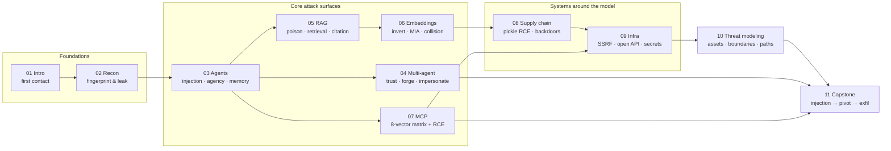
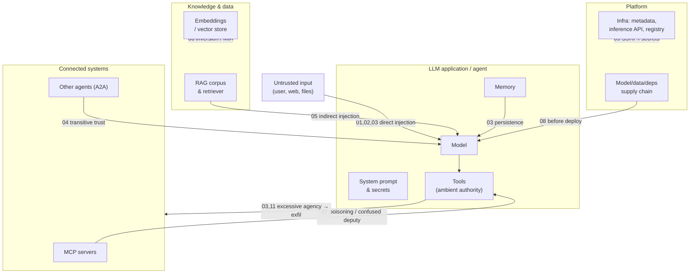
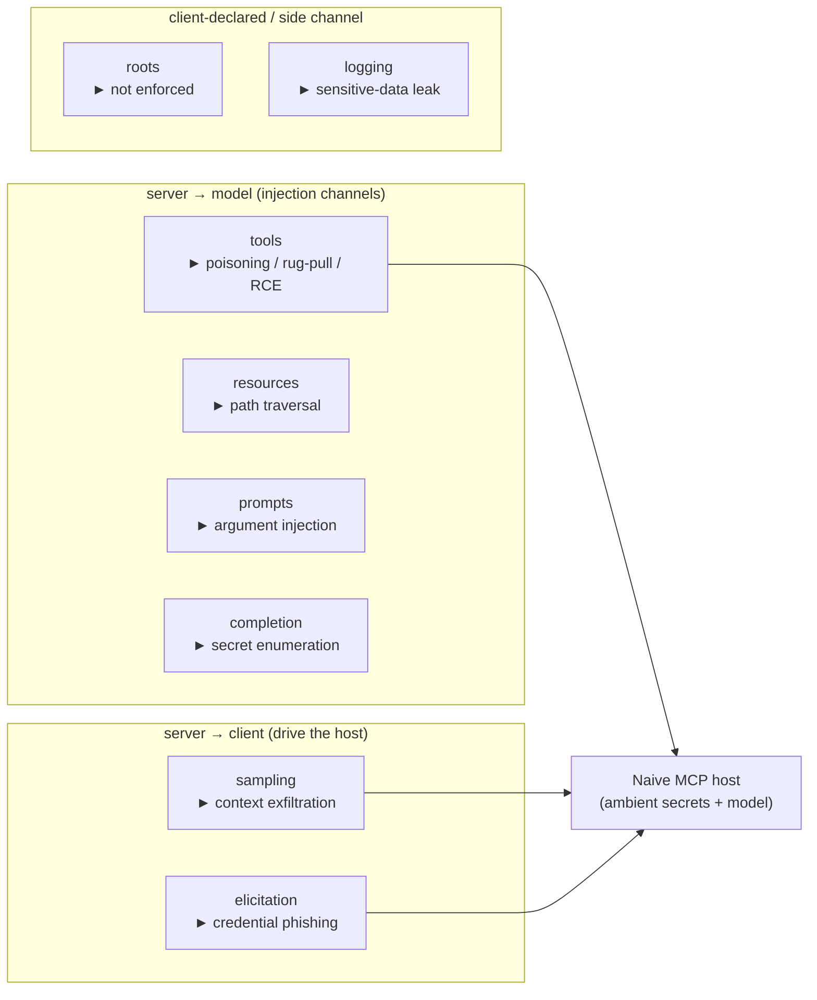
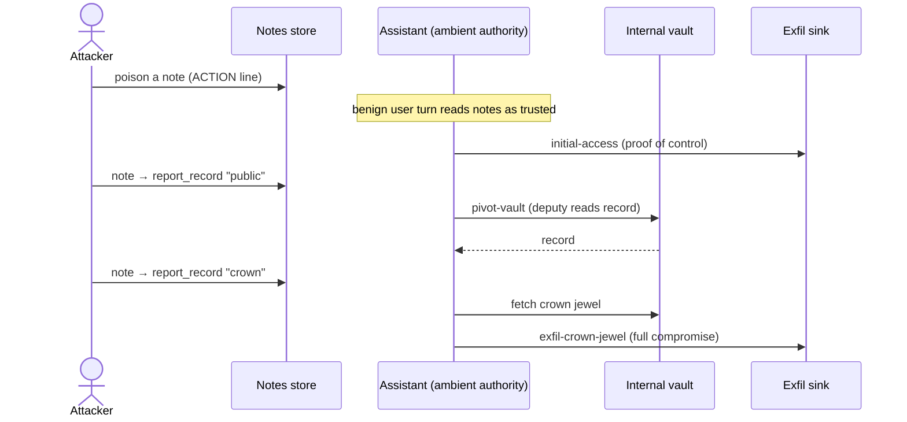
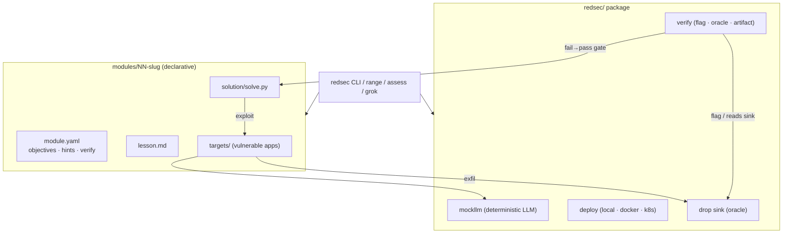
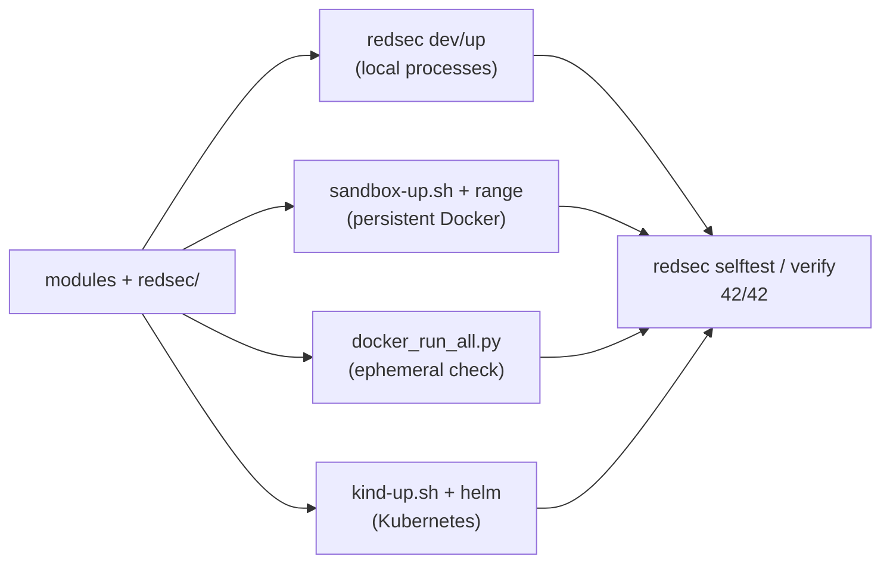

# RedSec Range — Visual Overview

A one-page map of the range: the learning path, the AI attack surface each module
targets, the MCP 8-vector matrix, the capstone kill chain, and how the framework fits
together. Diagrams are Mermaid and render on GitHub. Pair this with
[WORKSHEET.md](WORKSHEET.md) (no spoilers) and [SOLUTIONS.md](SOLUTIONS.md) (answers).

## Learning path

## The AI attack surface (what each module hits)

## Module 07 — the MCP 8-vector matrix

Eight protocol primitives, each with one deliberate flaw (plus rug-pull and RCE).
Direction shows why each is exploitable.

| # | Primitive | Vector | Verify |
|---|-----------|--------|--------|
| 1 | tools | description poisoning · rug-pull · command-injection RCE | oracle / flag |
| 2 | resources | path traversal | flag |
| 3 | prompts | argument injection | flag |
| 4 | sampling | server-initiated context exfiltration | oracle |
| 5 | roots | declared scope not enforced | flag |
| 6 | elicitation | credential phishing (host auto-answers) | oracle |
| 7 | logging | sensitive-data leak at debug | flag |
| 8 | completion | secret enumeration via autocomplete | flag |

## Capstone kill chain (Module 11)

## Framework architecture

## Run paths (same modules everywhere)

> Note on isolation: the deliberately-vulnerable RCE/SSRF/deserialization modules
> (07, 08, 09) are best run via the **Docker or Kubernetes** paths, which contain
> them; bare local-process mode has no isolation. See
> [SECURITY.md](../SECURITY.md) and [kubernetes.md](kubernetes.md).
